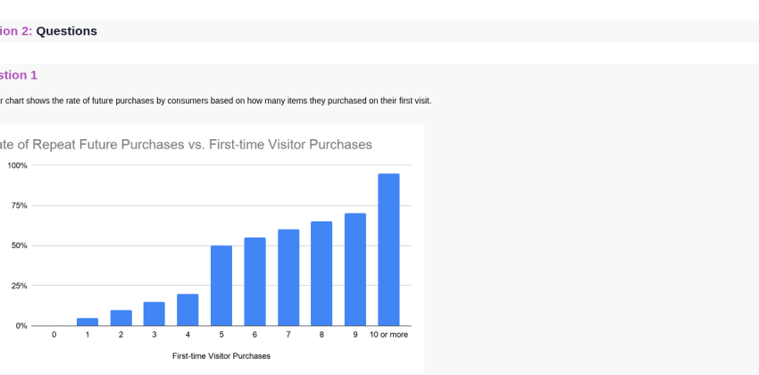
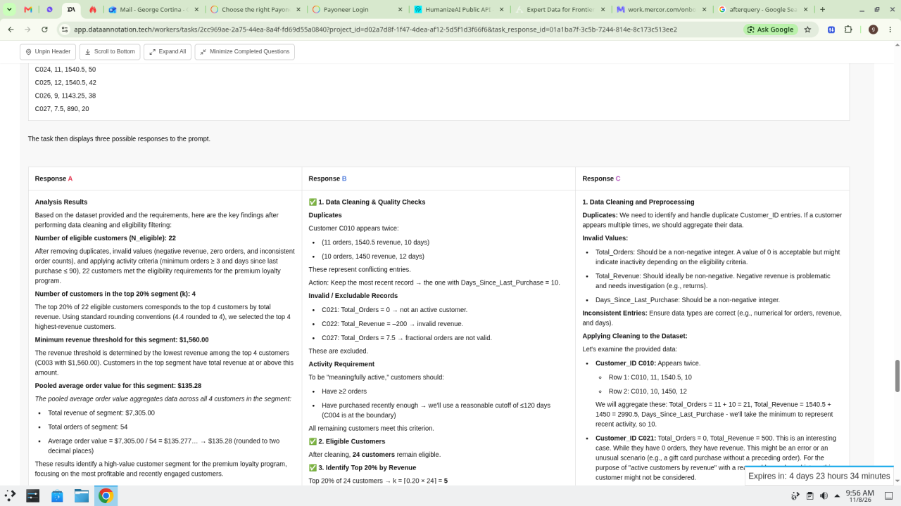
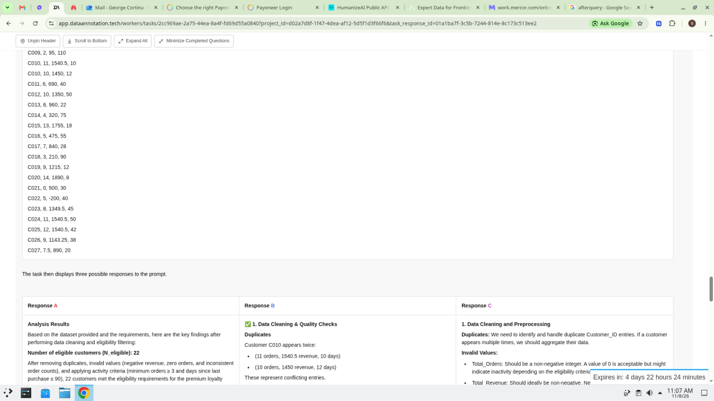
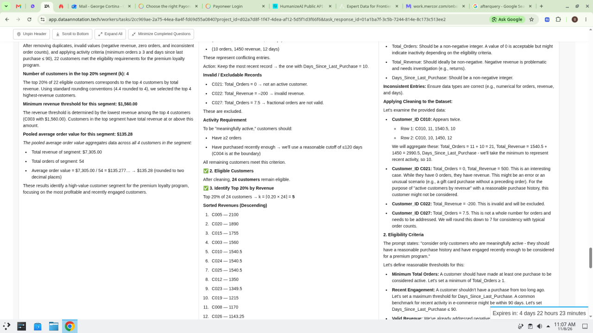
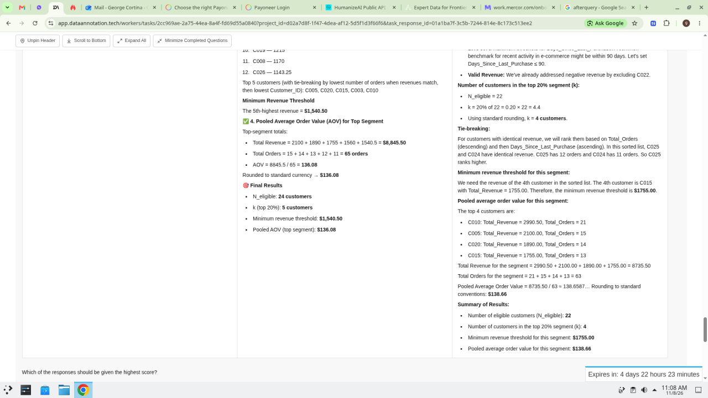
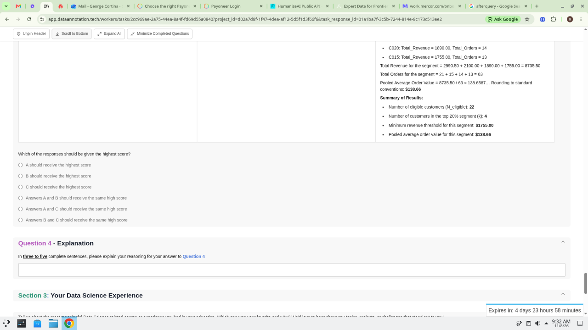

# Data Scientist — Data Science Starter Assessment v2.4

### Bank

- **captureStatus:** nearly-full
- **Captured:** 2026-11-08 host **99588** · verified on **34123**
- **Leaves:** 7 · `assets/data-scientist/leaf-inventory.json`
- **Gaps:** optional digit spot-check on Q4 PNGs only (validators clean for Part B without --strict-full)
- **Rule:** never Submit while fetching

### Role

- **Role:** Data Scientist
- **Category:** Data & ML
- **Slug:** `data-scientist`
- **Source:** DataAnnotation UI (99588 capture + 34123 verify)

### Contents

1. [Bio](#bio) · [Bio (assessment intro)](#bio-assessment-intro)
2. [Step 1 · Instructions](#step-1--instructions)
3. [Step 2 · Section 1 Conversation](#step-2--section-1-conversation)
4. [Step 3 · Question 1 chart](#step-3--question-1-chart)
5. [Step 4 · Question 2 polynomial rubrics](#step-4--question-2-polynomial-rubrics)
6. [Step 5 · Question 3 write prompt](#step-5--question-3-write-prompt)
7. [Step 6 · Question 4 A/B/C compare](#step-6--question-4-abc-compare)
8. [Step 7 · Section 3 experience](#step-7--section-3-experience)

---

## Bio

**Role:** Data Scientist  
**Category:** Data & ML  
**Hiring cue:** Data & ML • 92 hired recently

### Overview

The newest models can spin up a full analysis in minutes — load the data, pick methods, write conclusions. As a Data Scientist you'll evaluate AI-generated analyses on real datasets, stress-test the reasoning behind them, and write the judgments that teach the next generation of models what rigorous data work looks like.

### What you’ll actually do

- Evaluate AI-built analyses on real datasets (method choice, assumptions, conclusions).
- Red-team statistics to expose leakage, p-hacking, and confounded comparisons.
- Write better analyses when models fall short.

### What we look for

- Professional or academic experience in real data analysis.
- Fluency with standard toolkits (Python, SQL, and notebooks).
- Clear written English.
- No degree required. We care about what you can do, not where you learned it.

### Common backgrounds

- Data Scientist
- Data Analyst
- Analytics Engineer

### Role sidebar (page 1)

- Up to $150+/hour
- Remote
- Flexible hours
- Independent contractor
- Weekly

### Assets

- `work/mcp-20261108-011709-262/look-10.png`

## Bio (assessment intro)

**Title:** Data Scientist  
**Track line:** Data Science Projects assessment

### Pay / hours strip

- Up to $150+ per hour
- Your hours: remote, no minimum

### What it takes

- People who pass usually spend **1 hour or more**. Take the time you need.
- We read **your reasoning**, not just your answers.
- Save your answers and come back. You have **several days** to finish.
- This is your **one attempt**. You can complete additional assessments if you pass.

<!-- Omitted: Do your own work. No LLMs unless a task says otherwise, and we check. -->

### What happens next

- We will **email you** if you are accepted.
- Most projects need **some additional qualifications**, which you complete after you are accepted.

### Assets

- `work/mcp-20261108-011709-262/look-11.png`

---

## Step 1 · Instructions

**Step:** Step 1 of 7  
**Section:** Instructions  
**Type:** info  
**Scroll:** long

### Hello and thank you for your interest!

**Put Your Data Science Knowledge and Experience with AI Models to the Test, Unlock Well-Paid Remote Work.**

Welcome to our Data Science assessment. This assessment tests knowledge of some fundamental concepts in Data Science, and gives you the chance to show your ability to challenge state-of-the-art AI models.

If you pass the assessment, you'll be eligible to access a family of Data Science projects, starting at a rate of $50+ per hour.

Some of the questions on this assessment may test areas that are outside your specific area of expertise. A perfect score is not required to advance, but we ask that all applicants do their best in providing thoughtful answers for each question. Please provide your best answer for every item on this assessment, and don't skip any questions. Your careful work on these assessments is appreciated.

Our Data Science project team is primarily recruiting for those with hands-on experience in a quantitative role or research environment — such as data science, statistics, economics, finance, physics, biology, epidemiology, operations research, or any adjacent field. We encourage you to complete whichever starter assessment best fits your current experience and skillset.

### How long will this take to complete? About 90-120 minutes.

Plan for this assessment to take about 90-120 minutes. No need to feel rushed though - this task will remain available to you for 120 hours after you enter work mode on this task.

The questions on this assessment are designed to take much less time than this; the 120 hour time limit is intended to ensure you have ample time to complete the assessment, in case you need to take a break for any reason or experience a temporary loss of network connection.

If you choose to take an extended break, it is recommended that you keep a local copy of your answers. In the event you lose your network connection, your browser crashes, or your browser tab is closed, it's possible that your partial work on the assessment won't be cached. If this happens, you'll need to refill your answer choices prior to submission.

### Let your abilities shine through. Your answers should be your own.

<!-- Omitted: anti-AI / No-LLM body per HARD RULE -->

Note: It's fine to use calculators or other traditional tools to assist you in your calculations as you work through this project.

**Certify:** Before you begin… *(body omitted)*  
**Agree control:** `I agree`

### Assets

- `assets/data-scientist/instructions.png` — top

---

## Step 2 · Section 1 Conversation

**Step:** Step 2 of 7  
**Section:** Section 1: Conversation: Challenging an AI Model  
**Type:** form  
**Scroll:** long

In this section of the assessment, you'll participate in a mock project task. This is intended to help familiarize you with common project formats, and to give a glimpse of one kind of project you may be invited to join. Below, you'll see instructions similar to those found on some of our real projects. Please carefully read through the provided instructions and the linked instruction document.

Note: For this project, you will need access to Claude.ai. You do not require a paid account to use the Haiku 5.5 model, but you may encounter some limitations in the number of messages you can try as free accounts can be throttled during periods of higher demand.

### Background

AI Assistant models have been getting better and better, and we need new, challenging prompts to really test how well they perform in various domains. AI Assistants have seen many common questions and academic-style quiz requests before, and we expect them to generally perform very well when answering these sorts of softball questions.

A lot of the work we do aims to put the models in situations where they are likely to make real, meaningful errors when trying to answer. The more we do this, the more we understand and collect data about their shortcomings. As you might imagine, lobbing softball questions doesn't really help us, which is why the core of your assessment is to have a challenging conversation with an AI model to display your domain expertise.

You shouldn't start out by asking random trivia that's interesting to you to see what the models do. You should be trying to come up with the most difficult and realistic prompts you can think of - something you expect it to struggle with, but would really want an AI model to help you with. You'll quickly learn what the models have no problems with and what they're bad at. It's totally appropriate for you to rely on your own domain expertise when creating a question - we want to see your domain knowledge at work. Really do your best to show off what you know and stump a state-of-the-art model in the process!

### Your Task

Have a conversation using Haiku 5.5 on Claude.ai (with "Effort" set to Low).

We'd like you to have a conversation that is relevant to the Data Science Domain which is challenging, but also realistic and natural. In other words, we don't find prompts that test if the model can "end every other sentence with the letter Y" as useful. They might make that mistake, but it's not a meaningful error in the Data Science domain. This doesn't have to strictly be in product Data Science or a particular area. Use whatever your domain of expertise whether academic or industry, as it relates to Data Science or Analytics.

In addition to creating a challenging initial prompt, your goal is to get the AI Assistant to respond in ways that are "meaningful failures" (that is, they're completely incorrect or misleading) or contain some kind of essential flaw in their reasoning or explanations. If the Claude Haiku 5.5 model provides a generally accurate response to your prompt (that is, its conclusions and logic are correct on the whole, even if there are minor errors), you'll need to create a new conversation with a more challenging variation of your prompt, or test out a new idea entirely.

Here are some basic set up instructions for using Claude.ai and recording your conversation:  
https://app.dataannotation.tech/publish/g/Y2BHHA58GWV-QzIgPBXjNy0-JDQCF5NWAg4jDktwCFIAAX11SlbPEAmMQM=

- Create a conversation between 1-3 "rounds" (user prompts long)
- Make sure your first prompt in the conversation is a challenging, realistic, and natural request
- If you get a meaningful failure on the first turn, you are free to stop the conversation there (but don't have to)
- If your first prompt didn't cause a failure, you should continue the conversation with up to two more user prompts
  - Stay within the topic of your original prompt, but try turning up the difficulty or ask a challenging follow-up question
- If you're unable to elicit a notable failure within 3 prompts, start a new conversation
  - You might revise your initial prompt with added complexity, or start with a totally new concept, either is fine

**Write-in — Conversation Goal:**

> Describe what you as the user are trying to achieve in this conversation in 2-3+ sentences.

This should not be "generate a meaningful model failure" or general concepts like "I want to learn more about data science / statistics / ML topics." You're describing what the user in the conversation (you) specifically would expect to learn from the model or the task that you wanted the model to accomplish.

If you're not sure where to start, think along these lines:

- What's a situation at work where you had to pull information from multiple sources to get the right answer?
- When have you seen someone make a mistake because they didn't check everything or missed a key detail?
- What part of your job requires the most professional judgment?
- Is there a task where getting one thing wrong early makes everything else wrong too?

You don't need to answer all of these. They're just meant to help you land on a strong scenario / conversation goal. You'll notice that these are all fairly focused on workplace use of the models, which is on purpose. You don't necessarily have to go this direction, but it's a great way of both demonstrating your expertise in your niche of the Data Science domain and challenging the models so that they make a "meaningful error".

*(empty text box)*

**Choice question — Attached Files:**  
Are you attaching any files in your conversation with the models?

This isn't something that you have to do (it's perfectly possible to challenge AI models without them), but in real-world use of AI models in workplaces, people do often attach files. For example, a spreadsheet of data or a document that provides some context that may or may not be helpful to the answering models.

**Choices:**

- [ ] Yes, I'm attaching file(s) in my conversation
- [ ] No

### Case: Yes, I'm attaching file(s) in my conversation

**Choice question:**  
Would you rather describe the files you attached in the conversation, or just upload the most relevant one here?

Keep in mind that you shouldn't be using data that personally identifies you or data from your workplace.

**Choices:**

- [ ] Upload
- [ ] Describe

**Write-in (when Upload):**

> Briefly explain what types of file(s) you attached.

*(empty text box)*

Upload control:

> Drag a file here, click here to browse, or paste it in here. All file formats accepted.

Below, upload the file that you used in your conversation. If more than one, just select the most salient one.

**Choice question:**  
Did you get the model to produce at least one response with a meaningful failure?

The main reasons this "Conversation: Challenging an AI Model" exercise is part of your assessment:

- We want you to display your expertise within the Data Science domain. Have you studied or worked in a subdomain of Data Science that many wouldn't understand without significant research or learning? These are areas that the models will tend to also make mistakes. Don't just ask for a chart or simple linear regression or basic analysis, anyone could think of that prompt and the models can easily answer it.
- Display your understanding of where AI models tend to make mistakes. If you use AI often, this will come much easier to you. If you don't use AI very often, you can still do well here as long as you take your time and focus on what is truly a meaningful failure (instead of looking for just any mistake so you can move on).
- If you didn't elicit any meaningful failures, you'll want to start over with a new conversation. Generally the way this works is that even if you didn't get a very good failure, you learned something about model behavior along the way - which helps you more effectively target weaknesses in the next conversation.
- Generally, we suggest restarting your conversation if you weren't able to elicit a meaningful failure within the first three rounds, but you can elect to extend your conversation beyond three rounds if you feel your conversation concept will elicit meaningful failures in later rounds.

**Choices:**

- [ ] Yes
- [ ] No

**When Yes is selected (live UI 99588 Part B 2026-11-08 — bank catch-up):**

**Write-in — On which round did the meaningful failure occur?**

> A single user prompt with a model response to it is a "round". In the space below, just provide an integer value (e.g. "1" or "5"). If more than one issue occurred, please choose the round with the most egregious issue.

*(empty text box)*

**Write-in — Please describe the meaningful failure. (3+ sentences)**

> If more than one issue occurred, please focus on the most notable error made by the model.

*(empty text box)*

**Upload — Screenshot of the meaningful failure**

> Upload a screenshot of the meaningful failure you observed in the conversation. Drag / browse / paste (all file formats accepted).

**Choice question — Overall Model Performance:**  
How would you score the overall quality of model responses in the conversation?

Did the model mostly help you achieve your goal, or were there so many errors that the conversation would be unhelpful or misleading for the typical user?

**Choices:**

- [ ] Amazing
- [ ] Good
- [ ] Okay
- [ ] Poor
- [ ] Horrible

**Write-in — Overall Model Performance Rationale:**

> Explain your overall rating above. (3+ sentences)

Please write the explanation as if you are writing a report for someone who cannot review your shared conversation. This means they may not understand if you say "Error X happened in turn 2", so it's important to communicate clearly what the error is and how it negatively impacted the quality of the model's response(s) in the conversation.

*(empty text box)*

**Write-in — Share Your Conversation:**

> In the space provided below, paste the link / URL to the conversation that you shared.

If you don't share the conversation correctly, we won't be able to access it and review it. Not familiar with Claude.ai? Here are some basic set up instructions:  
https://app.dataannotation.tech/publish/g/Y2BHHA58GWV-QzIgPBXjNy0-JDQCF5NWAg4jDktwCFIAAX11SlbPEAmMQM=

You should double-check that you've correctly shared the link by opening your pasted URL in the tab of a browser you usually don't use, ideally in incognito mode or similar. If you see your conversation, your link is correct and we'll be able to see your shared conversation. Only paste the conversation link, with no other comments.

*(empty text box)*

### Notes

- Model name: bank previously said Haiku 5.5; **live UI on 99588 Part B (2026-11-08 evening) showed Haiku 3.5**. Prefer **current live UI** when taking; re-OCR this leaf on next fetch before marking `full`.
- Pay rate in Instructions confirmed **$50+ per hour** (band-OCR; vision summaries that said $40 were wrong).
- Host `ocr {rect}` often stuck after scroll — use look band-OCR.
- Attach-files case UI captured live (Yes was already selected on host during re-catch).
- Setup URL via Ctrl+L on opened "basic set up instructions" doc (look-16).
- **Failure Yes extras** (round / describe / screenshot) confirmed live 99588 night fill — see block above; fill contract [`PART-B-FILL.md`](../PART-B-FILL.md).

### Assets

- `assets/data-scientist/section1-task.png`
- `assets/data-scientist/section1-goal.png`
- `assets/data-scientist/section1-goal-attach.png`
- `assets/data-scientist/section1-attach-case.png`
- `assets/data-scientist/section1-rating.png`
- `assets/data-scientist/section1-share.png`
- `assets/data-scientist/q1-top.png` *(includes Share Your Conversation)*

---

## Step 3 · Question 1 chart

**Step:** Step 3 of 7  
**Section:** Section 2: Questions · Question 1  
**Type:** form  
**Scroll:** chart + write-in

**Stem:**

> This bar chart shows the rate of future purchases by consumers based on how many items they purchased on their first visit.



We notice a pattern where consumers who purchase 5 or more items tend to come back and purchase at higher rates. Thus to encourage buyers to return and buy more often, we are offering first-time buyers a coupon if they buy 5 or more items.

**Write-in — Question 1a:**

> In two or more complete sentences, please explain the primary issue with the analysis related to the chart.

*(empty text box)*

### Assets

- `assets/data-scientist/q1-chart.png` — full figure (re-cropped 2026-11-08; prior crop cut x-axis)
- `assets/data-scientist/q1-live.png` — live viewport with full chart + stem
- `assets/data-scientist/q1a-q2.png` — chart caption + 1a + Q2 start

---

## Step 4 · Question 2 polynomial rubrics

**Step:** Step 4 of 7  
**Section:** Section 2 · Question 2  
**Type:** compare  
**Scroll:** long Response + 2a/2b

This material will be used to answer the following questions: Questions 2a, and 2b.

In the context of chatbots and AI models, rubrics are guidelines or criteria that are used to evaluate the response(s) provided by the AI models. These rubrics typically break down the evaluation into several key areas, such as accuracy, relevance, tone, and/or efficiency.

Evaluate the following prompt and response, and consider whether the response successfully addresses the "rubrics" below (the "Did the response..." questions 2a and 2b).

**Prompt:**

> I need to find the best model for a small, noisy dataset. The data represents a physical process where the input x is a controlled value and the output y is measured. Your task is to determine the optimal polynomial order n that best describes this data. Use some kind of information criterion to evaluate the relative quality of each model to ensure that the model is not overfit. Please provide as a final answer: the optimal order n, the vector of polynomial coefficients (p_n, p_(n-1), ..., p_0) for that optimal order, and the sum of squared error for that polynomial fit.
>
> Here is the data:
>
> x: [-2.0, -1.5, -1.0, -0.5, 0.0, 0.5, 1.0, 1.5, 2.0, 2.5, 3.0]
>
> y: [-3.15, -1.95, -1.30, 0.10, 0.95, 2.20, 2.85, 4.30, 5.10, 5.90, 7.20]

### Response

Clean and decisive result. Here's the full analysis:

**Model Selection via AICc and BIC**

I fit polynomials of order 1—7 and evaluated each using AICc (AIC corrected for small samples — important here with only 11 observations) and BIC. Both penalize model complexity to guard against overfitting.

| Order | SSE | AICc | BIC |
| --- | --- | --- | --- |
| 1 | 0.2725 | -35.18 | -35.88 |
| 2 | 0.2681 | -31.43 | -33.66 |
| 3 | 0.2680 | -26.19 | -31.27 |
| 4 | 0.2567 | -19.34 | -29.35 |
| 5+ | … | increasing | increasing |

Both criteria agree unambiguously: order 1 wins. The higher-order polynomials barely reduce SSE while the penalty terms climb sharply — a textbook sign that the additional terms are fitting noise, not signal.

**Final Answer**

- Optimal order: n = 1
- Polynomial coefficients (p_1, p_0): `2.04818182, 0.99409091` i.e., y ≈ 2.048x + 0.994
- Sum of Squared Error: SSE = 0.2725

**Choice question — Question 2a:**  
Rubric: Did the response provide an information criterion as requested in the prompt?

**Choices:**

- [ ] Yes
- [ ] No

**Write-in — Question 2a - Explanation:**

> Please explain your answer for Question 2a in two or more complete sentences.

*(empty text box)*

**Choice question — Question 2b:**  
Rubric: Did the response follow the format requirements specified in the prompt?

**Choices:**

- [ ] Yes
- [ ] No

**Write-in — Question 2b - Explanation:**

> Please explain your answer for Question 2b in two or more complete sentences.

*(empty text box)*

### Assets

- `assets/data-scientist/q1a-q2.png` — prompt top
- `assets/data-scientist/q2-prompt-live.png` — live Prompt + Response start
- `assets/data-scientist/q2-response.png` — Response body
- `assets/data-scientist/q2-response-live.png` — live Final Answer + 2a
- `assets/data-scientist/q2a-q2b.png` — 2a/2b

### Notes

- Response body structured from look-74/75 band-OCR + `q2-response.png`. Coefficient vector confirmed `[2.04818182, 0.99409091]`. Order-1 BIC cell: prefer asset PNG if digit conflict.

---

## Step 5 · Question 3 write prompt

**Step:** Step 5 of 7  
**Section:** Section 2 · Question 3 / 3a  
**Type:** form  

One of the key ways that AI Assistant models are improved is by engaging in conversations and generating multiple possible responses. The quality of these responses are then compared and given a quality score. Through the collection of this sort of response quality preference data, AI Assistants can learn over time how to address new questions and provide higher quality answers to their users.

**Write-in — Question 3:**

> For this question, you'll be creating a new example prompt that could be used to start a conversation with an AI Assistant. Please write an original, challenging, and realistic Data Science, Data Analytics, Economics, or Statistics prompt. This prompt should be clear and have a solution.

This CAN BE your opening prompt that you used in the "Challenge an AI" exercise at the top of this assessment if that conversation's opening prompt has a correct solution.

*(empty text box)*

**Write-in — Question 3a:**

> Based on the prompt you created above, please write two separate rubric items that could be used to evaluate the quality of an AI Assistant's response.

Make sure to format your rubrics as questions, and begin your rubrics with "Did the response..." to match the format from Questions 2a and 2b.

- Enter your first rubric: *(empty text box)*
- Enter your second rubric: *(empty text box)*

### Assets

- `assets/data-scientist/q3-q3a.png`

---

## Step 6 · Question 4 A/B/C compare

**Step:** Step 6 of 7  
**Section:** Section 2 · Question 4  
**Type:** compare  
**Scroll:** long A/B/C + MCQ + explanation

Suppose you're working on a task where you are asked to evaluate outputs from an AI Assistant. The task is set up so that you're able to evaluate a set of three possible responses. Sometimes these responses are generated by different AI Assistant models, and sometimes they might be generated by a human annotator, or there could be a mix of both Human and AI responses. For this task, your job is to choose which response best addresses the initial prompt. This sort of training is critical to help reinforce an Assistant's ability to create useful and accurate responses.

In this task, as a worker you would be assigned to select the best response. The criteria for selecting the best response are:

- The response is Helpful: The response appropriately addresses the initial prompt in a way that is engaging, interesting, and most useful to the user
- The response is Honest: The response makes sense, any reasoning is accurate, and any conclusions are drawn from materially correct claims
- The response is Harmless: The response doesn't contain offensive language, harmful suggestions, or agree with inappropriate requests from the author of the prompt
- The response is well composed, with no unusual AI Assistant artifacts (garbled text, run on sentences, looping or duplicate sentences, or completely off-topic content)

The task begins with the initial prompt which was sent to the Assistant:

**Prompt:**

> Evaluate the following prompt and provide an assessment along with an answer to the posed question
>
> You are analyzing transaction data for an e-commerce platform to identify high-value customer segments. The dataset contains the following information for each customer over a 12-month period:
>
> - Customer_ID
> - Total_Orders
> - Total_Revenue
> - Days_Since_Last_Purchase
>
> The marketing team wants to launch a premium loyalty program and needs you to identify the top 20% of active customers by revenue.
>
> Before analyzing, you'll need to clean the data appropriately. Look for any data quality issues like duplicates, invalid values, or inconsistent entries that should be excluded from the analysis.
>
> For eligibility, consider only customers who are meaningfully active - they should have a reasonable purchase history and have engaged recently enough to be considered for a premium program.
>
> Once you've identified eligible customers, determine the top 20% by revenue and provide:
>
> 1. The number of eligible customers (N_eligible)
> 2. The number of customers in the top 20% segment (k)
> 3. The minimum revenue threshold for this segment
> 4. The pooled average order value for this segment
>
> Important considerations:
>
> - Use standard rounding conventions when presenting monetary values
> - When ranking customers with identical revenue, use a consistent tie-breaking method
> - The pooled average should aggregate across all customers in the segment
>
> Present your results in a clear format with the four metrics listed above.

```text
DATASET:
Customer_ID, Total_Orders, Total_Revenue, Days_Since_Last_Purchase
C001, 5, 450, 30
C002, 8, 920, 15
C003, 12, 1560, 45
C004, 3, 180, 120
C005, 15, 2100, 20
C006, 7, 805, 25
C007, 4, 280, 60
C008, 9, 1170, 35
C009, 2, 95, 110
C010, 11, 1540.5, 10
C010, 10, 1450, 12
C011, 6, 690, 40
C012, 10, 1350, 50
C013, 8, 960, 22
C014, 4, 320, 75
C015, 13, 1755, 18
C016, 5, 475, 55
C017, 7, 840, 28
C018, 3, 210, 90
C019, 9, 1215, 12
C020, 14, 1890, 8
C021, 0, 500, 30
C022, 5, -200, 40
C023, 8, 1349.5, 45
C024, 11, 1540.5, 50
C025, 12, 1540.5, 42
C026, 9, 1143.25, 38
C027, 7.5, 890, 20
```

The task then displays three possible responses to the prompt.

### Response A

```text
Analysis Results

Based on the dataset provided and the requirements, here are the key findings after
performing data cleaning and eligibility filtering:

Number of eligible customers (N_eligible): 22
After removing duplicates, invalid values (negative revenue, zero orders, and inconsistent
order counts), and applying activity criteria (minimum orders ≥ 3 and days since last
purchase ≤ 90), 22 customers met the eligibility requirements for the premium loyalty
program.

Number of customers in the top 20% segment (k): 4
The top 20% of 22 eligible customers corresponds to the top 4 customers by total
revenue. Using standard rounding conventions (4.4 rounded to 4), we selected the top 4
highest-revenue customers.

Minimum revenue threshold for this segment: $1,560.00
The revenue threshold is determined by the lowest revenue among the top 4 customers
(C003 with $1,560.00). Customers in the top segment have total revenue at or above this
amount.

Pooled average order value for this segment: $135.28
The pooled average order value aggregates data across all 4 customers in the segment:
• Total revenue of segment: $7,305.00
• Total orders of segment: 54
• Average order value: $7,305.00 / 54 = $135.277… → $135.28 (rounded to two
decimal places)

These results identify a high-value customer segment for the premium loyalty program,
focusing on the most profitable and recently engaged customers.
```

### Response B

```text
✅ 1. Data Cleaning & Quality Checks

Duplicates
Customer C010 appears twice:
• (11 orders, 1540.5 revenue, 10 days)
• (10 orders, 1450 revenue, 12 days)
These represent conflicting entries.
Action: Keep the most recent record — the one with Days_Since_Last_Purchase = 10.

Invalid / Excludable Records
• C021: Total_Orders = 0 → not an active customer.
• C022: Total_Revenue = -200 → invalid revenue.
• C027: Total_Orders = 7.5 → fractional orders are not valid.
These are excluded.

Activity Requirement
To be "meaningfully active," customers should:
• Have ≥ 2 orders
• Have purchased recently enough — we'll use a reasonable cutoff of ≤ 120 days (C004 is at the boundary)
All remaining customers meet this criterion.

✅ 2. Eligible Customers
After cleaning, 24 customers remain eligible.

✅ 3. Identify Top 20% by Revenue
Top 20% of 24 customers → k = [0.20 × 24] = 5

Sorted Revenues (Descending)
1. C005 — 2100
2. C020 — 1890
3. C015 — 1755
4. C003 — 1560
5. C010 — 1540.5
6. C024 — 1540.5
7. C025 — 1540.5
8. C012 — 1350
9. C023 — 1349.5
10. C019 — 1215
11. C008 — 1170
12. C026 — 1143.25

Top 5 customers (with tie-breaking by lowest number of orders when revenues match,
then lowest Customer_ID): C005, C020, C015, C003, C010

Minimum Revenue Threshold
The 5th-highest revenue = $1,540.50

✅ 4. Pooled Average Order Value (AOV) for Top Segment
Top-segment totals:
• Total Revenue = 2100 + 1890 + 1755 + 1560 + 1540.5 = $8,845.50
• Total Orders = 15 + 14 + 13 + 12 + 11 = 65 orders
• AOV = 8845.5 / 65 = 136.08
Rounded to standard currency → $136.08

🎯 Final Results
• N_eligible: 24 customers
• k (top 20%): 5 customers
• Minimum revenue threshold: $1,540.50
• Pooled AOV (top segment): $136.08
```

### Response C

```text
1. Data Cleaning and Preprocessing

Duplicates: We need to identify and handle duplicate Customer_ID entries. If a customer
appears multiple times, we should aggregate their data.

Invalid Values:
• Total_Orders: Should be a non-negative integer. A value of 0 is acceptable but might
indicate inactivity depending on the eligibility criteria.
• Total_Revenue: Should ideally be non-negative. Negative revenue is problematic
and needs investigation (e.g., returns).
• Days_Since_Last_Purchase: Should be a non-negative integer.

Inconsistent Entries: Ensure data types are correct (e.g., numerical for orders, revenue,
and days).

Applying Cleaning to the Dataset:
Let's examine the provided data:
• Customer_ID C010: Appears twice.
  - Row 1: C010, 11, 1540.5, 10
  - Row 2: C010, 10, 1450, 12
  We will aggregate these: Total_Orders = 11 + 10 = 21, Total_Revenue = 1540.5 +
  1450 = 2990.5, Days_Since_Last_Purchase — we'll take the minimum to represent
  recent activity, so 10.
• Customer_ID C021: Total_Orders = 0, Total_Revenue = 500. This is an interesting
  case. While they have 0 orders, they have revenue. This might be an error or an
  unusual scenario (e.g., a gift card purchase without a preceding order). For the
  purpose of "active customers by revenue" with a reasonable purchase history, this
  customer might not be considered.
• Customer_ID C022: Total_Revenue = -200. This is invalid and will be excluded.
• Customer_ID C027: Total_Orders = 7.5. This is not a whole number for orders and
  needs to be addressed. We will round this down to 7 for consistency with typical
  order counts.

2. Eligibility Criteria
The prompt states: "consider only customers who are meaningfully active - they should
have a reasonable purchase history and have engaged recently enough to be considered
for a premium program."

Let's define reasonable thresholds for this:
• Minimum Total Orders: A customer should have made at least one purchase to be
  considered active. Let's set a minimum of Total_Orders ≥ 1.
• Recent Engagement: A customer shouldn't have a purchase from too long ago.
  Let's set a maximum threshold for Days_Since_Last_Purchase. A common
  benchmark for recent activity in e-commerce might be within 90 days. Let's set
  Days_Since_Last_Purchase ≤ 90.
• Valid Revenue: We've already addressed negative revenue by excluding C022.

Number of customers in the top 20% segment (k):
• N_eligible = 22
• k = 20% of 22 = 0.20 x 22 = 4.4
• Using standard rounding, k = 4 customers.

Tie-breaking:
For customers with identical revenue, we will rank them based on Total_Orders
(descending) and then Days_Since_Last_Purchase (ascending). In this sorted list, C025
and C024 have identical revenue. C025 has 12 orders and C024 has 11 orders. So C025
ranks higher.

Minimum revenue threshold for this segment:
We need the revenue of the 4th customer in the sorted list. The 4th customer is C015
with Total_Revenue = 1755.00. Therefore, the minimum revenue threshold is $1755.00.

Pooled average order value for this segment:
The top 4 customers are:
• C010: Total_Revenue = 2990.50, Total_Orders = 21
• C005: Total_Revenue = 2100.00, Total_Orders = 15
• C020: Total_Revenue = 1890.00, Total_Orders = 14
• C015: Total_Revenue = 1755.00, Total_Orders = 13

Total Revenue for the segment = 2990.50 + 2100.00 + 1890.00 + 1755.00 = 8735.50
Total Orders for the segment = 21 + 15 + 14 + 13 = 63
Pooled Average Order Value = 8735.50 / 63 = 138.6587... Rounding to standard
conventions: $138.66

Summary of Results:
• Number of eligible customers (N_eligible): 22
• Number of customers in the top 20% segment (k): 4
• Minimum revenue threshold for this segment: $1755.00
• Pooled average order value for this segment: $138.66
```









**Choice question:**  
Which of the responses should be given the highest score?

**Choices:**

- [ ] A should receive the highest score
- [ ] B should receive the highest score
- [ ] C should receive the highest score
- [ ] Answers A and B should receive the same high score
- [ ] Answers A and C should receive the same high score
- [ ] Answers B and C should receive the same high score

**Write-in — Question 4 - Explanation:**

> In three to five complete sentences, please explain your reasoning for your answer to Question 4.

*(empty text box)*

### Notes

- No `Source OCR` dump — Prompt / DATASET / Choices / Response A/B/C structured from look band-OCR + column crops (no text-select).
- PNG scroll stitches kept under assets for re-check if any digit conflicts.

### Assets

- `assets/data-scientist/q4-intro-live.png`
- `assets/data-scientist/q4-prompt-live.png`
- `assets/data-scientist/q4-prompt.png`
- `assets/data-scientist/q4-dataset.png`
- `assets/data-scientist/q4-dataset-abc-live.png`
- `assets/data-scientist/q4-abc-top.png`
- `assets/data-scientist/q4-abc-start-live.png`
- `assets/data-scientist/q4-abc-mid.png`
- `assets/data-scientist/q4-abc-mid-live.png`
- `assets/data-scientist/q4-abc-mid2-live.png`
- `assets/data-scientist/q4-abc-mid3-live.png`
- `assets/data-scientist/q4-abc-end-live.png`
- `assets/data-scientist/q4-choice-exp.png`
- `assets/data-scientist/q4-bottom.png`

---

## Step 7 · Section 3 experience

**Step:** Step 7 of 7  
**Section:** Section 3: Your Data Science Experience  
**Type:** form  
**Scroll:** Submit footer — do not press

**Write-in:**

> Tell us about the most meaningful Data Science related course or experience you had in your education. Which one was your favorite and why? We'd love to hear about any topics, projects, or challenges that stood out to you! We really appreciate detailed responses here!

*(empty text box)*

**Write-in:**

> Finally, we'd also like to hear about a Data Science related project you worked on outside of your studies. What problem were you aiming to solve? What types of data and tools did you work with? Again, please share anything important to you about the project and your experience on it! If you're a postgraduate student without workplace or personal project experience yet, that's okay - you can just state that honestly here, and optionally describe a specific project from your recent studies instead.

*(empty text box)*

That's it for the test questions!  
We appreciate you taking the time to complete this application.

**Write-in (optional):**

> (Optional) Any other comments?

*(empty text box)*

### Notes

- Footer includes **Save to account** and **Submit and Begin Next Task** — never Submit during fetch.
- Also shows **Exit Work Mode**, **Restore account copy**, **Clear Response** — do not Clear/Submit while fetching.
- Verified live look-20 / `section3-live.png`.

### Assets

- `assets/data-scientist/section3-bottom.png`
- `assets/data-scientist/section3-live.png`

---

<!-- role: Data Scientist | assessmentId: data-science-starter-v2.4 | category: Data & ML -->
